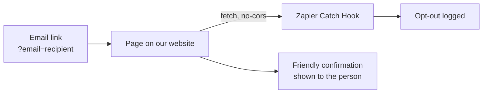

# One-click email webhooks

A one-click "unsubscribe" link for a mail-merge campaign, with no email platform features required.

## The problem

We ran an outreach campaign to hundreds of dental practices through a Zapier mail merge, sent from a personal mailbox. The goal was a clear answer from every practice: fill in the survey, or say no. Saying no had to take one click, and every opt-out had to be logged automatically so that person never got another follow-up.

A Zapier Catch Hook can log a click, but it only shows a bare "success" JSON response to the person who clicked. That's a confusing experience for a recipient.

## How it works

1. Each email carries a personal link: `https://yoursite.com/unsubscribe?email=<merge tag>`.
2. The page reads the email from the URL and fires the webhook in the background.
3. The person sees a clean "You've been unsubscribed" card, or an error card with a fallback.

## Use it

1. Create a Zap with a **Webhooks by Zapier > Catch Hook** trigger and copy its URL.
2. Paste the URL into `WEBHOOK_URL` in [`pages/unsubscribe.html`](pages/unsubscribe.html).
3. Host the page on your site (any page that accepts custom HTML).
4. Link to it from the email with your platform's merge tag for the recipient's email.
5. Test with your own address and check that the hit lands in Zapier.
